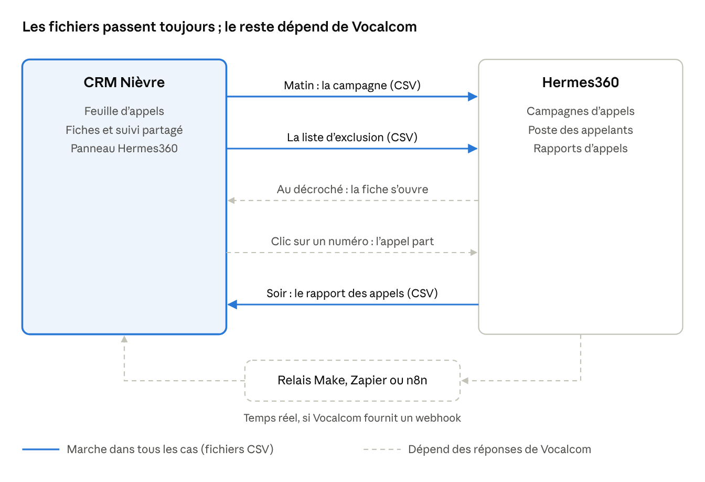

Le CRM est prêt à servir : 500 entreprises de la Nièvre classées, 471 numéros, des interlocuteurs finance ou RH pour 60 entreprises, et un suivi des appels partagé entre associés. Il est compatible avec Hermes360 par échange de fichiers ; seules l'ouverture automatique de la fiche et la synchronisation en temps réel dépendent des réponses de Vocalcom.

## Accès et partage

Le CRM ne dépend pas de Claude : il est hébergé sur Firebase, le service de Google, sous le compte des associés, à une adresse du type crm-nievre.web.app. Il s'ouvre dans le navigateur, sur ordinateur comme sur téléphone, sans rien installer.

- **Pour y accéder**, chaque associé se connecte avec son compte Google. Son adresse doit avoir été autorisée une fois par l'administrateur, dans les réglages de la base.
- **Personne d'autre ne lit les fiches ni le suivi** : l'adresse publique ne montre qu'un écran de connexion.
- **Le suivi est partagé en temps réel** : un appel noté par un associé apparaît chez les autres en quelques secondes. Le témoin en haut à droite indique « Suivi partagé, synchronisé ».
- **Mettre à jour le CRM** (nouvelles données, nouvelle version) : bouton « Mettre à jour », puis les trois fichiers du dépôt ; le suivi des appels n'est pas touché.
- **Installation** : environ 30 minutes, une seule fois, décrite pas à pas dans le guide du dépôt (autonome/LISEZMOI.md). L'offre gratuite de Firebase suffit pour 2 à 4 associés.
- **Propriété** : le code, les données et le suivi restent chez les associés, dans leur dépôt GitHub et leur projet Firebase.

## Les cinq vues

Le CRM tient en cinq onglets ; on passe la journée entre « Aujourd'hui » et « Appels ».

| Vue | À quoi elle sert | Ce qu'on y trouve |
| --- | --- | --- |
| Aujourd'hui | Le tableau de bord du jour | Rendez-vous des 5 jours ouvrés, rappels du jour, 5 prochains appels ; avancement par vague ; appels de l'équipe et part des appels joints ; meilleurs créneaux d'appel ; qualité des fiches ; carte des vagues |
| Appels | La feuille d'appels | « Prochain appel », puis les groupes : à rappeler aujourd'hui, rendez-vous, pas encore appelées, sans date de rappel, prochains rappels, numéro à trouver ; résultat noté en un geste ; filtres par appelant et par vague ; agenda (.ics), export CSV, panneau Hermes360 |
| Entreprises | Les 500 fiches | Recherche par nom, ville, interlocuteur ou numéro ; filtres de priorité, secteur, statut, coordonnées et interlocuteurs ; tris (dont « fiches à enrichir d'abord ») ; export CSV qui suit les filtres |
| Culture | 97 artistes et structures culturelles à démarcher | Le même suivi que pour les entreprises |
| Mémo d'appel | L'aide pendant l'appel | Discours, réponses aux objections, dispositif fiscal, calcul à faire avec le client, cadre légal, simulateur |

## Une journée d'appels

Une journée se déroule en huit gestes, et le CRM propose à chaque fois la suite.

1. **Ouvrir « Aujourd'hui »** : rendez-vous à venir, rappels du jour avec leur heure, cinq prochains appels.
2. **Passer à « Appels »**, filtrer sur son nom si besoin : la carte « Prochain appel » dit qui appeler.
3. **Lire l'encadré d'appel de la fiche** : standard, personne à demander, consigne, et « Pourquoi appeler maintenant » quand un fait récent le justifie.
4. **Composer** : un clic sur le numéro marque la fiche « en appel » pendant 20 minutes, pour qu'un autre associé n'appelle pas en même temps.
5. **Pendant l'appel**, le Mémo d'appel donne le discours, les réponses aux objections et le calcul à faire avec le client.
6. **Noter le résultat** : Pas de réponse, Répondeur et Bloqué au standard en un geste ; À rappeler (date et heure), Intéressé, Rendez-vous, Faux numéro, Pas intéressé et Ne plus contacter par « Autre résultat ».
7. **Laisser le CRM planifier** : rappel au jour ouvré suivant (hors fériés), au plus 4 appels en 30 jours, relance à 3 jours pour un intéressé. Noter aussi le nom donné par le standard et tout numéro trouvé.
8. **« Appel suivant »** enchaîne. L'agenda (.ics) reprend les rendez-vous et rappels dans le calendrier de chacun.

## La fiche d'une entreprise

Chaque fiche réunit ce qu'il faut pour l'appel en haut, et le détail en dessous.

- **Encadré d'appel** : le standard et sa fiabilité (« à confirmer », « confirmé par deux sources », « standard du groupe »), la ligne directe notée, les personnes à demander (finance, RH, direction, dirigeant), la consigne, les boutons de résultat et « Appel suivant ».
- **Pour l'appel** (125 fiches approfondies) : l'angle à prendre, les questions à poser, les points de vigilance.
- **Interlocuteurs** : responsables finance, RH, administration et direction de site trouvés par la recherche, avec leur niveau de certitude, puis les mandataires au registre.
- **Suivi**, saisi par l'équipe : statut, responsable, interlocuteur, coordonnées directes, prochaine action, date et heure de rappel, rendez-vous, notes et historique daté de chaque échange.
- **Potentiel œuvres d'art** : régime fiscal, résultat, plafond annuel de déduction (le plus élevé de 20 000 € ou 5 ‰ du chiffre d'affaires), montant d'œuvres déductibles sur 5 ans et économie d'impôt ; grisé quand l'entreprise est en perte.
- **Messages prêts à copier** : le mail d'approche (masqué pour les entreprises opposées à la prospection) et la note pour l'expert-comptable.
- **Entreprise** : activité, effectif, chiffres, adresse, site, LinkedIn, actualités datées, SIREN et lien Pappers.
- **Comptes liés** : sociétés du même dirigeant ou du même groupe, à traiter dans le même appel quand elles sont encore en campagne.
- **Fiabilité des données** : pour chaque information, son niveau, sa source et sa date, avec un score de complétude sur 100.

## Les données

Les 37 cibles prioritaires ont toutes un standard, mais une bonne partie des informations reste à confirmer au premier appel. Chiffres au 29/10/2026, sur 485 entreprises actives (500 dans le CRM, dont 11 en procédure collective, 3 hors campagne et 1 activité peut-être cessée).

| Donnée | Couverture | Ce qu'il faut savoir |
| --- | --- | --- |
| Classement | Priorité haute 57 (vague 1 : 10, vague 2 : 13, vague 3 : 34), moyenne 296, basse 132 | 37 cibles prioritaires parmi les 100 premières ; la vague 1 est à Cosne |
| Standard téléphonique | 471 sur 500 ; 37 sur 37 cibles | 283 viennent d'un seul annuaire (« à confirmer »), 29 sont le standard d'une société du groupe ; 15 entreprises actives n'ont aucun numéro publié |
| Dirigeants | 458 | Registre national (Pappers) ; un mandataire peut être ancien |
| Interlocuteurs finance, RH, administration | 60 entreprises, 78 personnes | Responsable finance nommé pour 28 entreprises (4 confirmés), dont 10 des 37 cibles ; les autres noms ne sont pas publiés : demander au standard qui tient la comptabilité |
| Comptes | 2025 : 142 ; 2024 : 177 ; 2023 : 46 ; non publiés : 119 | Sans comptes publiés, le plafond de déduction est estimé ; 86 entreprises étaient en perte au dernier exercice (économie d'impôt théorique) |
| Régime fiscal | Impôt sur les sociétés : 298 ; probable : 151 ; à vérifier : 36 | La déduction ne vaut que pour une société à l'IS bénéficiaire, à faire valider par son expert-comptable |
| E-mail générique, site web | 107 e-mails ; 281 sites | Seules des adresses publiées par l'entreprise elle-même ; aucune adresse devinée |
| Opposition à la prospection | 14 entreprises opposées | Vérifiée pour 33 entreprises seulement : contrôler la fiche Pappers avant tout e-mail |
| Comptes liés | 124 fiches | Même dirigeant ou même groupe : un appel peut couvrir plusieurs sociétés |
| Complétude | 52 sur 100 en moyenne ; 60 pour les cibles | Le tri « fiches à enrichir d'abord » montre où compléter |

Le plafond annuel de déduction des 37 cibles va de 28 639 € (Parqueterie Beau Soleil) à 835 000 € (Textilot), médiane 84 840 €. Les chiffres viennent du registre national, de Pappers, des comptes publiés et de recherches web contre-vérifiées entre le 21 et le 28 octobre 2026.

## Règles à respecter

Le CRM applique déjà ces règles ; il faut les connaître pour ne pas les contourner.

- **Refus de prospection** : « Ne plus contacter » retire l'entreprise de la feuille d'appels, du mail d'approche et de la campagne. Le refus est daté et gardé 3 ans, comme le recommande la CNIL.
- **Opposition relevée sur Pappers ou un annuaire** (14 entreprises) : appel direct possible, mais pas d'e-mail de prospection.
- **Coordonnées** : uniquement des coordonnées professionnelles publiées ; jamais une adresse e-mail devinée (prénom.nom@…).
- **Rythme** : au plus 4 appels en 30 jours vers la même entreprise ; pas d'enregistrement des appels.
- **E-mail** : possible sans accord préalable s'il concerne la fonction de la personne ; chaque message dit qui l'envoie et offre un moyen simple de se désinscrire.
- **Vente à une très petite entreprise** (5 salariés au plus, hors de nos locaux) : information précontractuelle, contrat écrit avec formulaire de rétractation, 14 jours de rétractation, aucun paiement avant 7 jours.
- **Fiscalité** : nous ne donnons pas de conseil fiscal ; le montage (régime, plafond, exposition, réserve spéciale) est toujours validé par l'expert-comptable de l'entreprise.
- **Conservation** : un prospect sans réponse est supprimé 3 ans après le dernier contact ; seule la liste des refus est gardée.

## Compatibilité avec Hermes360

Le CRM fonctionne avec Hermes360 dans tous les cas, par échange de fichiers ; seules l'ouverture automatique de la fiche et la mise à jour en temps réel dépendent de ce que Vocalcom permet. Tout se fait depuis le panneau « Hermes360 » de la vue Appels.

En trait plein, ce qui marche dès l'achat : la campagne et l'exclusion partent le matin, le rapport revient le soir. En pointillé, ce que seules les réponses de Vocalcom débloqueront.

| Niveau | Ce que ça donne au quotidien | Condition côté Hermes360 | Où on en est |
| --- | --- | --- | --- |
| 1. Fichiers | Le matin, la campagne et la liste d'exclusion partent du CRM ; le soir, le rapport des appels revient dans le CRM (environ 2 minutes) | Import de campagne en CSV (confirmé par Vocalcom) et export des rapports en CSV (annoncé par Vocalcom) | Prêt dans le CRM, testé sur des fichiers d'essai |
| 2. Fiche et numérotation | La fiche s'ouvre toute seule au décroché ; un clic sur un numéro du CRM lance l'appel dans Hermes360 | Le script sait ouvrir une adresse web avec des variables ; Vocalcom fournit une adresse de numérotation | Prêt dans le CRM, à confirmer par Vocalcom |
| 3. Temps réel | Chaque appel arrive dans le CRM quelques secondes après avoir raccroché | Un webhook ou une API, plus un relais (Make, Zapier ou n8n) : 1 à 2 jours de mise en place | Non documenté publiquement par Vocalcom |

**Ce que fait l'import du soir**

- Il reconnaît les colonnes du rapport (date, heure, numéro, clé CRM, qualification, agent, durée, commentaire, date de rappel), même sous d'autres noms.
- Il associe chaque qualification de Hermes360 à l'un des 9 résultats du CRM, et chaque agent à un associé ; ces choix sont gardés pour la fois suivante.
- Il met à jour statuts, rappels, refus et rendez-vous avec les mêmes règles qu'un appel noté à la main ; un « Ne plus contacter » s'applique toujours.
- Il ne reprend jamais deux fois le même appel, et une saisie plus récente dans le CRM garde la main.
- Il bloque une ligne douteuse jusqu'à décision : numéro partagé par plusieurs sociétés, clé et numéro en désaccord, heure manquante, date future, numéro abîmé par Excel.
- Il montre un aperçu avant d'écrire, et le dernier import peut être annulé.

**Réglages conseillés dans Hermes360** : des qualifications au libellé exact du CRM (Pas de réponse, Répondeur, Bloqué au standard, À rappeler, Intéressé, Rendez-vous fixé, Faux numéro, Pas intéressé, Ne plus contacter) ; la colonne cle_crm gardée comme champ libre ; le mode « aperçu » ou « progressif » ; l'enregistrement des appels désactivé.

**Ce qu'on sait de Hermes360.** C'est la suite de centre de contacts de Vocalcom (anciennement Hermes.Net et Hermes Pro). Son connecteur officiel ne se branche que sur Salesforce, Microsoft Dynamics et Zendesk, et Vocalcom ne publie ni documentation d'API, ni webhooks, ni connecteur Zapier ou Make. Les prix sont sur devis : l'offre « Hermes Essentials » sur AWS coûte 175 200 $ sur 12 mois pour 200 agents, et des sites tiers estiment 55 à 190 $ par poste et par mois (non confirmé). L'étude du 22/10/2026 jugeait Hermes360 surdimensionné pour 2 à 4 associés ; Aircall et Ringover documentent déjà webhooks et Zapier, ce qui permettrait le temps réel dès aujourd'hui.

## Questions à poser à Vocalcom avant de signer

Demander les réponses par écrit, avec deux fichiers d'exemple : un modèle d'import de campagne et un rapport d'appels exporté. Avec ces deux fichiers, la compatibilité se vérifie en quelques minutes dans le CRM.

1. Le poste de l'agent ou le script peut-il ouvrir une adresse web au décroché, avec des variables (numéro, champ importé, campagne) ? Dans le même onglet ou un nouvel onglet ?
2. Peut-on lancer un appel depuis une page web qui n'est pas un CRM du marché : lien « tel: », adresse avec le numéro, extension de navigateur ?
3. Une colonne libre (notre cle_crm) importée avec le contact ressort-elle telle quelle dans l'export des appels ?
4. Quel modèle CSV pour l'import : format des numéros (+33, 0…, 0033), séparateur, encodage, nombre de champs personnalisés ?
5. Les qualifications sont-elles réglables, pour reprendre exactement nos neuf résultats ?
6. Le journal des appels (date, numéro, clé, qualification, agent, durée, commentaire, rappel) peut-il partir chaque soir par e-mail ou SFTP ?
7. Existe-t-il une API (REST ou SOAP) ? Authentification, quotas, inclusion dans l'offre, documentation et compte d'essai avant signature ?
8. Existe-t-il une notification de fin d'appel ou de qualification (webhook) ? Avec quel contenu, et est-elle signée ?
9. Peut-on créer un rappel daté réservé à un appelant, par l'écran ou par API ?
10. Quel format pour la liste d'exclusion, et peut-on l'alimenter par API ?
11. Le « connecteur universel » s'applique-t-il à un CRM maison ? À quel prix et dans quel délai ?
12. Quel prix pour 2 à 4 postes, communications comprises, et quelle durée d'engagement ?

## Décisions et prochaines étapes

Le CRM peut servir dès maintenant, avec ou sans Hermes360 ; trois décisions restent à prendre.

- [ ] Installer la version autonome sur Firebase (guide autonome/LISEZMOI.md) et autoriser l'adresse de M. Carlone et de chaque associé.
- [ ] Choisir le nom de la structure qui vend les œuvres, pour l'intégrer au discours et aux messages.
- [ ] Commencer les appels par la vague 1 (10 entreprises à Cosne), en confirmant chaque standard « à confirmer » dès le premier appel.
- [ ] Envoyer les douze questions à Vocalcom et demander les deux fichiers d'exemple, puis choisir entre Hermes360, Aircall ou Ringover, ou le téléphone seul.
- [ ] Faire valider par un expert-comptable le dispositif de déduction avant la première vente.
- [ ] Vérifier sur Légifrance que le consentement préalable au démarchage téléphonique, obligatoire depuis le 11/08/2026, ne vise que les consommateurs.

## Sources

Les informations sur Hermes360 viennent de recherches web (titres et extraits de pages) menées du 22 au 28/10/2026, sans contact avec Vocalcom ; l'étude complète liste toutes les sources avec leurs dates.

- Guide d'installation du CRM autonome : fichier autonome/LISEZMOI.md du dépôt du projet
- Étude Hermès (Vocalcom) et alternatives, jointe au rapport en PDF (partie 3.4 sur l'intégration au CRM)
- [Connecteur HUCC, fiche de l'éditeur](https://appexchange.salesforce.com/image_host/ebf1cc4c-c612-424a-a848-3e48d99b70c4.pdf)
- [Vocalcom, connecteurs CRM](https://www.vocalcom.com/fr/logiciel-call-center/integration-centre-contact/multi-connecteurs-crm/)
- [Vocalcom, rapports d'activité](https://www.vocalcom.com/kpis-call-centers/call-center-reporting/)
- [Vocalcom, téléprospection et import de fichiers](https://www.vocalcom.com/fr/logiciel-teleprospection/)
- [Offre Hermes Essentials sur AWS Marketplace](https://aws.amazon.com/marketplace/pp/prodview-472lcww6dyici)
- [Aircall, webhooks](https://developer.aircall.io/docs/webhooks)
- [Ringover, API publique](https://support.ringover.com/hc/en-us/articles/15206971712657-Using-our-API)
- [CNIL, prospection commerciale](https://www.cnil.fr/fr/la-prospection-commerciale-par-courrier-electronique-sms-mms-et-automate-dappel)
- [Firebase, tarifs](https://firebase.google.com/pricing)
